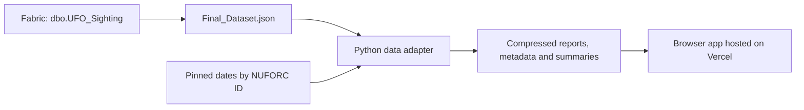

# UFO Observatory

We built UFO Observatory for our Vlerick Modern Data Platforms group assignment. We use Microsoft Fabric to prepare our data and a responsive web app to explore the reports through maps, charts, filters, and original source accounts.

**[Open our live app](https://ufo-observatory-vlerick.vercel.app)**

## What we explore

Our exploratory question is: **Where and when do people in the United States report UFO sightings, and how do the reported shapes vary?**

We use the app to:

- Select a state on our map and compare report counts.
- Explore occurrence years, months, local hours, and reported shapes with linked charts.
- Search summaries, read individual records, and follow their original NUFORC links.
- Combine filters, share a filtered URL, and export the selected reports as CSV.
- Use the same views on desktop and mobile, with an alien mascot and sourced UFO fun facts.

We interpret these as patterns in **self-reported accounts**. A report does not establish an extraterrestrial explanation, and several reports may describe one event.

## Our current data

We use `Final_Dataset.json`, our cleaned export from Fabric table `dbo.UFO_Sighting`, received on **3 November 2026**. Our app serves this snapshot; it does not query Fabric live.

| Measure | Current snapshot |
| --- | ---: |
| Unique report IDs retained | 139,903 |
| Reports mapped to the 50 US states and Washington, DC | 139,687 |
| Territory reports retained outside that map | 216 |
| Reports eligible for time charts | 139,888 |
| Pre-1900 dates retained with a review flag | 15 |
| Reports without a supplied summary | 68 |
| Source indicates media: Yes / No | 6,840 / 133,063 |

Our usable occurrence dates span **6 July 1905 to 6 March 2026**. We preserve every supplied report ID and source link. We keep missing summaries missing, retain the source's `Unknown/Other` shape category, and distinguish an explicit `No` media label from missing information.

We found mixed month/day and day/month formats in the export. We resolve each date against a pinned reference using its original NUFORC ID, preserve the exported date text, and stop the import if a date cannot be reconciled. We explain our rules and source fingerprints in [our data preparation guide](docs/data-preparation.md).

## Run our app locally

We use **Node.js 24**. Running the committed app requires no package installation, build step, Fabric login, or API key. We need Python 3 only when regenerating the data files.

```sh
git clone https://github.com/maximvanhaute/ufo-observatory.git
cd ufo-observatory
node scripts/serve.mjs
```

We then open **http://127.0.0.1:4173**. Our supplied server sets the gzip headers needed to load the compressed report partitions; opening `index.html` directly will not load the app correctly.

We run our automated checks with:

```sh
node --test tests/data-engine.test.mjs
```

Our current suite has **12 tests**. Our [verification record](docs/verification.md) distinguishes automated checks, full source reconciliation, and sampled browser checks.

## How our data reaches the app



We commit the generated snapshot and the code needed to load it. We keep the original `Final_Dataset.json` outside Git. We use 14 compressed report partitions, each containing at most 10,000 records, to keep individual files manageable. Our browser recomputes chart counts from the filtered report records.

## Our repository

| Location | What we keep there |
| --- | --- |
| `dist/` | Our deployable HTML, CSS, JavaScript, and visual assets |
| `dist/data/` | Our generated snapshot, metadata, summaries, facts, and Census boundaries |
| `scripts/import_final_dataset.py` | Our Fabric-export adapter and date checks |
| `scripts/reference-dates.json.gz` | Our pinned date-only lookup by original report ID |
| `scripts/serve.mjs` | Our local server, including gzip response headers |
| `tests/` | Our data-engine and loader regression checks |
| `docs/` | Our preparation rules, validation evidence, release steps, and AI disclosure |

## Our documentation

- [Data preparation and field definitions](docs/data-preparation.md)
- [Verification results and limits](docs/verification.md)
- [Development, data updates, and deployment](docs/development.md)
- [Our use of generative AI](docs/ai-disclosure.md)
- [Original image-generation prompts](docs/asset-prompts.md)
- [Our original cleaning notes](docs/Data%20Cleaning%20Steps.docx)

## Limits and reuse

We work with a **US-only cleaned export**, not the complete NUFORC archive. We display counts rather than population-adjusted rates. We treat hours as local wall-clock values because the source provides no timezones. Our map uses Census state boundaries rather than witness coordinates. Our current export supplies no duration field, and we have not joined duration from another dataset.

Our repository is public, but public availability does not establish permission to reuse the underlying report content. We do not assert a new open licence over NUFORC data; upstream reuse permission remains unresolved. We retain the [NUFORC terms](https://nuforc.org/terms/) link so readers can examine the source's conditions. The bundled D3 library has its own [ISC licence](dist/vendor/D3-LICENSE.txt).

We used **Codex** for code, data adaptation, checks, and documentation, and an **OpenAI image-generation tool** for our decorative artwork. We describe those contributions and the checks we performed in [our AI disclosure](docs/ai-disclosure.md). We remain responsible for the project and its interpretation.
